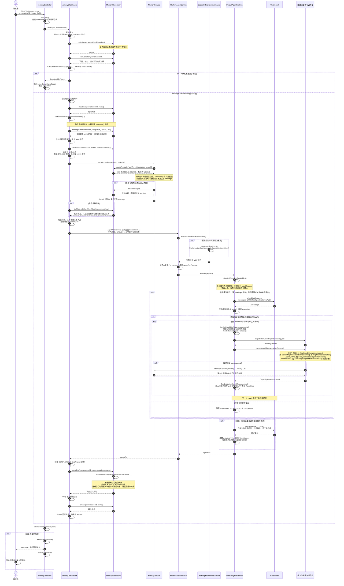

# 对话方法用例图

依据当前六模块代码梳理，节点标注实际类和方法。实线表示调用或执行分支，虚线表示结果返回或依赖装配。图聚焦会话聊天、无会话聊天、选库问答，以及 DAG 复用通用 Agent 的成功路径。

```mermaid
flowchart TB
    USER([用户])

    subgraph APP[openmanus-app · 对话入口]
        UI["chat.html 发送问题<br/>memoryUI.ensureConversation()"]
        MC["MemoryController.chat()<br/>POST /api/memory/chat"]
        AI["AIController.askStream()<br/>POST /api/ai/stream"]
        STREAM["StreamingChatServiceImpl.processAgentRequest()"]
        KC["KnowledgeController.chat()<br/>POST /api/knowledge/chat"]
        PG["PlatformAgentService.runGeneral()<br/>筛选本轮能力 → execute()"]
        PD["PlatformAgentService.runGeneralForWorkflow()"]
        SSE["SseEmitter.send() / complete()<br/>由对应 Controller 或 emit() 返回答案"]
    end

    subgraph CONTEXT[openmanus-context · 会话与知识]
        MEM["MemoryChatService.chat()"]
        PRE["MemoryRepository.claim() / conversation()<br/>messages() / summary() / taskResult()<br/>MemoryService.recall()<br/>租约、历史、任务结果和记忆上下文"]
        MODE{"knowledgeBaseIds 非空？"}
        CALLBACK["MemoryChatService.AgentAnswer.run()"]
        KB["KnowledgeChatService.answer()"]
        SEARCH["KnowledgeSearchService.search() / context()<br/>全文与向量召回 → RRF → 重排 → 来源校验<br/>有附件时调用 RagService.retrieveContext()"]
        KMODEL["ChatModel.chat()<br/>使用本轮证据和最近用户问题生成回答"]
        KRESULT["KnowledgeChatService.answer()<br/>追加检索来源与 warnings"]
        SAVE["MemoryRepository.complete()<br/>事务保存问答和任务最近结果<br/>finally 中 release()"]
        KI["KnowledgeCapabilityInvoker.invoke()<br/>answer → RagService.retrieveContext()<br/>search → KnowledgeSearchService.search()"]
        MI["MemoryCapability.invoke()<br/>MemoryService.recall()"]
    end

    subgraph RUNTIME[openmanus-runtime · Agent 执行]
        EXEC["DefaultAgentRuntime.execute()<br/>resolveCapabilities() / 组装消息"]
        MODEL["ChatModel.chat()<br/>模型生成答案或工具请求"]
        TOOL{"包含 ToolExecutionRequest？"}
        INV["DefaultAgentRuntime.invokeCapability()<br/>parseArguments() / 范围约束<br/>JsonSchemaValidator.validate()"]
        DIS["CapabilityInvokerRegistry.require()<br/>CapabilityInvoker.invoke()"]
        OBS["ToolExecutionResultMessage.from()<br/>记录 AgentStep 并进入下一轮模型调用"]
        RESULT["AgentRun<br/>finalAnswer / steps / status"]
    end

    subgraph TOOLS[openmanus-tools · 能力发现与执行]
        PROV["CapabilityProvisioningService.ensureAllEnabledMcpProviders()<br/>按需 refreshCapabilities()"]
        MCP["McpCapabilityInvoker.invoke()<br/>DefaultMcpInvocationService.invoke()<br/>McpClient.executeTool()"]
        LOCAL["FilesystemCapabilityInvoker.invoke()<br/>FilesystemTool 只读操作"]
    end

    subgraph WORKFLOW[openmanus-workflow · 复用入口]
        DAG["AgentDagNodeExecutor.execute()<br/>agentRef = general-chat-agent<br/>GeneralAgentRunner.run()"]
        DOUT["AgentDagNodeExecutor.completed()<br/>输出 AgentRun 给后续 DAG 节点"]
    end

    subgraph MODELS[openmanus-model · 模型装配]
        CONFIG["LangChain4jChatConfig.chatLanguageModel()<br/>ChatModelFactory.create()"]
    end

    USER --> UI --> MC --> MEM --> PRE --> MODE
    MODE -->|普通聊天| CALLBACK --> PG
    MODE -->|选库问答| KB --> SEARCH
    SEARCH -->|有知识库来源或本轮有附件| KMODEL --> KRESULT
    SEARCH -->|当前来源为空且无临时附件| KRESULT
    KRESULT -.->|会话调用| SAVE
    KRESULT -.->|无会话接口调用| SSE

    AI --> STREAM --> PG
    KC --> KB
    DAG --> PD --> PG
    PG -->|准备可用能力| PROV
    PG -->|组装 AgentRunRequest| EXEC
    EXEC --> MODEL --> TOOL
    TOOL -->|是| INV --> DIS
    DIS -->|MCP_TOOL| MCP
    DIS -->|LOCAL_TOOL| LOCAL
    DIS -->|KNOWLEDGE| KI
    DIS -->|MEMORY| MI
    MCP -.-> OBS
    LOCAL -.-> OBS
    KI -.-> OBS
    MI -.-> OBS
    OBS --> MODEL
    TOOL -->|否，得到最终答案| RESULT
    RESULT -.->|会话调用| SAVE
    RESULT -.->|无会话调用，经 PlatformAgentService.answer()| SSE
    RESULT -.->|DAG 调用| DOUT
    SAVE -.->|Future 完成后 whenComplete()| SSE
    SSE -.-> USER
    CONFIG -.->|注入默认 ChatModel| MODEL
    CONFIG -.->|注入默认 ChatModel| KMODEL
```

聊天页的普通发送会先确保会话存在，再调用 `/api/memory/chat`。首次使用的会话会经 `MemoryController.conversation()` → `MemoryService.createConversation()` → `MemoryRepository.createConversation()` 创建。`MemoryChatService.chat()` 先固定证据范围、领取租约、读取历史并召回记忆，然后根据知识库选择进入普通 Agent 或选库问答。 [聊天页](../../openmanus-app/src/main/resources/templates/chat.html) · [会话前端](../../openmanus-app/src/main/resources/static/js/memory.js) · [会话编排](../../openmanus-context/src/main/java/com/melon/memory/MemoryChatService.java)

普通聊天与 DAG 引用都由 `PlatformAgentService` 构造 `general-chat-agent`。会话入口通过 `OpenManusApplication.memoryAgentAnswer()` 绑定 `runGeneral()`，DAG 入口通过 `generalAgentRunner()` 绑定 `runGeneralForWorkflow()`。DAG 引用路径使用其映射输入，会话路径另有历史和记忆上下文。 [应用装配](../../openmanus-app/src/main/java/com/melon/OpenManusApplication.java) · [通用 Agent 门面](../../openmanus-app/src/main/java/com/melon/agent/runtime/PlatformAgentService.java) · [DAG Agent 节点](../../openmanus-workflow/src/main/java/com/melon/workflow/dag/executor/AgentDagNodeExecutor.java)

选库问答由 `KnowledgeChatService.answer()` 确定性检索后直接调用模型。该方法使用最近三个历史用户问题解释指代，知识事实取自本轮来源，`memoryContext` 参数当前未参与消息构造。通用聊天的能力筛选会排除 `knowledge.search`，有附件时才开放 `knowledge.rag.answer`。图中的 `search` 工具分支适用于显式授予该能力的 Agent，例如配置了能力白名单及知识库范围的内联 DAG Agent。 [知识问答](../../openmanus-context/src/main/java/com/melon/knowledge/KnowledgeChatService.java) · [能力筛选](../../openmanus-app/src/main/java/com/melon/agent/runtime/PlatformAgentService.java)

SSE 当前在模型执行完成后发送最终文本。成功的会话问答经 `MemoryRepository.complete()` 保存用户消息、助手回答及相关任务最近结果，再由 Controller 的完成回调返回。执行开始后的浏览器断开仍允许成功问答落库，排队期间断开可放弃执行。图中的回传分支按原始调用入口择一返回。 [会话返回](../../openmanus-app/src/main/java/com/melon/memory/MemoryController.java) · [会话保存](../../openmanus-context/src/main/java/com/melon/memory/MemoryRepository.java) · [无会话返回](../../openmanus-app/src/main/java/com/melon/service/impl/StreamingChatServiceImpl.java)

| 对话用例 | 关键方法链与约束 |
| --- | --- |
| 普通多轮对话 | `MemoryController.chat()` → `MemoryChatService.chat()` → `AgentAnswer.run()` → `PlatformAgentService.runGeneral()` → `DefaultAgentRuntime.execute()`。同一会话的证据范围固定，完成后事务保存问答 |
| 临时附件问答 | 先经 `AIController.uploadFiles()` → `FileStorageService.storeAll()` 上传，发送时携带 `fileIds`。Runtime 自主调用 `KnowledgeCapabilityInvoker.invoke()` → `RagService.retrieveContext()`，首次需要时在其中执行 `loadFileToRag()` |
| 指定知识库问答 | `MemoryChatService.chat()` → `KnowledgeChatService.answer()` → `KnowledgeSearchService.search()`，可附加临时附件上下文，再由模型生成答案并由服务端追加来源 |
| 无会话普通问答 | `AIController.askStream()` → `StreamingChatServiceImpl.processAgentRequest()` → `emit()`。异步任务执行 `PlatformAgentService.runGeneral()` 和 `answer()` 后发送最终文本 |
| 无会话知识库问答 | `KnowledgeController.chat()` → `KnowledgeChatService.answer()`，接口提供空历史 |
| MCP 工具调用 | `DefaultAgentRuntime.invokeCapability()` → `McpCapabilityInvoker.invoke()` → `DefaultMcpInvocationService.invoke()` → `McpClient.executeTool()`。调用前检查工具 Schema 及 Fetch、GitHub 安全策略 |
| 本地文件读取 | `DefaultAgentRuntime.invokeCapability()` → `FilesystemCapabilityInvoker.invoke()` → `FilesystemTool.listDirectory()`、`readFile()`、`searchFiles()` 或 `getFilesystemInfo()` |
| 模型再次召回记忆 | `DefaultAgentRuntime.invokeCapability()` → `MemoryCapability.invoke()` → `MemoryService.recall()`。Runtime 使用本轮服务端输入覆盖项目和任务参数 |
| DAG 复用对话 Agent | `AgentDagNodeExecutor.execute()` → `GeneralAgentRunner.run()` → `PlatformAgentService.runGeneralForWorkflow()` → 共同的 `runGeneral()`。成功的 AgentRun 由 `completed()` 转为节点输出 |

关键实现入口为 [Runtime 循环](../../openmanus-runtime/src/main/java/com/melon/agent/runtime/DefaultAgentRuntime.java)、[知识能力调用器](../../openmanus-context/src/main/java/com/melon/knowledge/KnowledgeCapabilityInvoker.java)、[记忆能力](../../openmanus-context/src/main/java/com/melon/memory/MemoryCapability.java)、[MCP 调用](../../openmanus-tools/src/main/java/com/melon/mcp/DefaultMcpInvocationService.java) 和 [附件检索](../../openmanus-context/src/main/java/com/melon/service/RagService.java)。

下面是普通多轮对话的方法级时序。前提为会话已存在、`knowledgeBaseIds` 为空，展示最终成功保存并返回答案的路径。`par` 表示 HTTP 线程准备异步响应与聊天线程池任务可交错执行，`whenComplete` 在结果可用且回调已注册后运行。



本轮用户消息和助手回答在 `MemoryRepository.complete()` 中成对提交，提交成功后再触发结果回调和 SSE 发送。生成之前，`summary()` 可能已经更新历史摘录。模型失败、答案为空或保存时租约失效，会经 Future 异常分支返回失败提示。浏览器在执行开始后断开时，后台仍可完成保存，Controller 会跳过向该连接发送结果。 [会话执行顺序](../../openmanus-context/src/main/java/com/melon/memory/MemoryChatService.java) · [事务保存](../../openmanus-context/src/main/java/com/melon/memory/MemoryRepository.java) · [SSE 完成回调](../../openmanus-app/src/main/java/com/melon/memory/MemoryController.java)

第一次 `MemoryService.recall(..., 6)` 由会话服务在模型调用前自动执行。模型运行中还可调用 `memory.recall`，再通过 `MemoryCapability.invoke()` 执行 `recall(..., 8)`。当前自动组装的记忆上下文采用条目正文，召回结果中的 `warnings` 由 Recall 返回，尚未被会话服务拼进该上下文。 [记忆召回](../../openmanus-context/src/main/java/com/melon/memory/MemoryService.java) · [模型记忆能力](../../openmanus-context/src/main/java/com/melon/memory/MemoryCapability.java)
