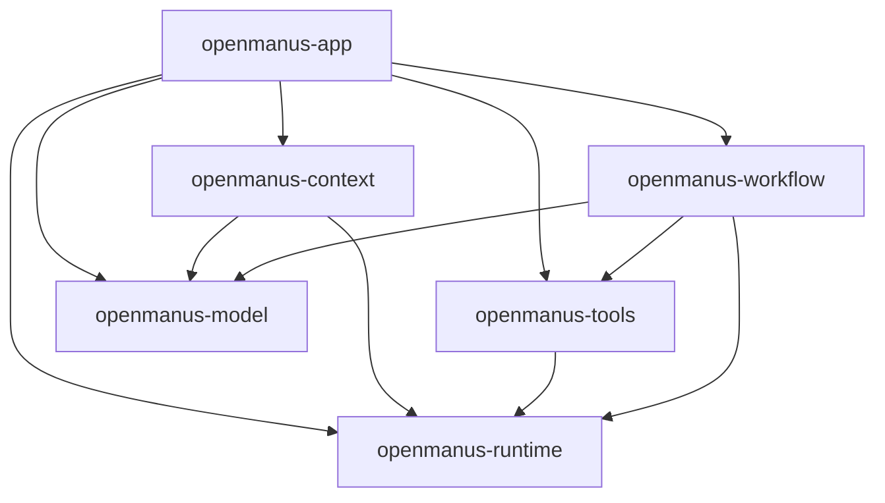
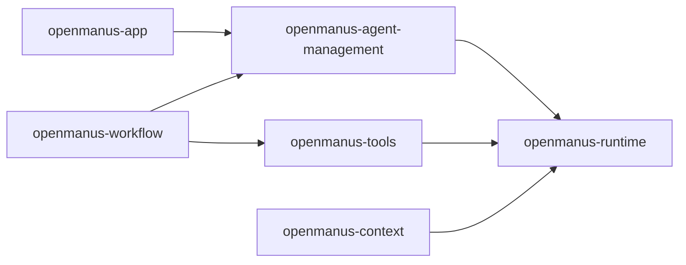

# OpenManus Maven 多模块拆分方案

建议以 **6 个子模块**完成现有代码的物理迁移，再加入 **`openmanus-agent-management`** 形成 Agent 平台的 7 模块目标结构，由一个 Spring Boot 应用部署。`openmanus-runtime` 是 Agent 执行内核，Memory 和 Knowledge 合并到 `openmanus-context`，MCP 调用与 Tools 合并到 `openmanus-tools`。六模块兼容验收和 Agent 管理上线分开提交，便于定位回归。

## 模块归属

| 模块 | 从现有代码迁入 | 对外边界 |
| --- | --- | --- |
| **`openmanus-runtime`** | `AgentRuntime`、`DefaultAgentRuntime`、`AgentDefinition`、`AgentRunRequest`、`AgentRun`、`AgentStep`、能力目录与调用 SPI、`CapabilityInvokerRegistry`、Runtime 配额配置、从 DAG 提出的通用 JSON Schema 校验器 | 执行一次 Agent Run。管理模型循环、能力白名单、参数校验、执行步数与轨迹。复用 LangChain4j `ChatModel` 接口，由应用注入模型 Bean |
| **`openmanus-context`** | `memory`、`knowledge` 的服务、仓储、索引任务与 SQL，`RagService`、`FileStorageService`、`UploadFile`、Docling、MinIO、`EmbeddingStoreConfig` 及相关配置 | 管理会话、任务、记忆召回、知识库检索和临时附件。发布 `MEMORY`、`KNOWLEDGE` 能力，向应用提供会话执行、选库问答和文件服务入口 |
| **`openmanus-tools`** | `mcp`、`tool`、`McpCapabilityInvoker`、`CapabilityProvisioningService`，以及拆出的文件系统注册器和调用器 | 管理 MCP Server 配置、连接、发现、刷新和执行。发布 `MCP_TOOL`、`LOCAL_TOOL` 能力，提供 `McpInvocationService` 和按 MCP provider 运行 Agent 的入口 |
| **`openmanus-workflow`** | `workflow` 下的 DAG、改编流程、角色模型选择、Redis 定义与运行仓储、节点执行器，以及对应配置 | DAG 的 AGENT 节点走 `AgentRuntime`，MCP_TOOL 节点走 `McpInvocationService`。改编流程保留独立的编排与模型角色策略 |
| **`openmanus-model`** | `LangChain4jChatConfig`、`LangChain4jStreamConfig`、`LangChain4jEmbeddingConfig`、`LangChain4jModelProperties`，以及从 `WorkflowModelGateway` 提出的 provider 构造逻辑 | 提供 Chat、Streaming Chat、Embedding Bean 和模型构造方法。Ollama、OpenAI 兼容客户端的实现依赖集中在这里 |
| **`openmanus-app`** | `OpenManusApplication`、全部 HTTP Controller、SSE 适配、`StreamingChatService`、通用聊天门面 `PlatformAgentService`、`application.yml`、`JacksonConfig`、模板与静态资源 | 组合模块，选择本轮问答模式与可用能力，提供 HTTP API 和页面。应用持有跨模块装配及旧配置兼容逻辑 |

首轮按现有职责迁移配置与辅助类。`AgentPlatformProperties` 按 `agent-platform.runtime` 与 `agent-platform.mcp` 分别绑定到 Runtime 和 Tools。`ToolSecurityProperties` 的 GitHub、Fetch、Filesystem 部分归 Tools，`docling` 部分归 Context，继续绑定现有键。Redis 附件缓存封装 `RedisCache` 跟随 Context，Redis 序列化 Bean 由 App 提供。`MySqlConnectionService` 跟随 App 的业务数据源接入。Context 内部保留 `memory`、`knowledge`、临时附件三条边界及各自的数据生命周期。

## 六模块迁移阶段的依赖方向

箭头表示直接 Maven 依赖。Runtime 和 Model 都没有项目内上游依赖。Runtime 对 `ChatModel` Bean 的需求由 App 装配解决。



Runtime 的公开面沿用 `AgentRuntime`、请求与结果 DTO、`CapabilityRegistry`、`CapabilityDescriptor`、`CapabilityInvoker` 和调用 DTO。Tools 与 Context 通过这些接口贡献能力。首轮保留现有 LangChain4j 消息类型、Jackson JSON 类型和按 `CapabilityType` 分派的机制。App 通过 Context 服务访问项目、任务、会话及文档下载。`MemoryController` 现有的仓储直调和 `KnowledgeController` 的对象存储访问收口到 Context 服务，上传接口首轮可继续用 `MultipartFile`。

## 拆分前要解开的依赖

1. **校验器从 DAG 迁入 Runtime。** `DefaultAgentRuntime`、`DefaultMcpInvocationService` 和 `DagWorkflowService` 共用 `DagJsonSchemaValidator`。迁成 Runtime 中可复用的 `JsonSchemaValidator`，沿用现有校验语义和错误格式。这样 Workflow 与 Tools 都只依赖 Runtime。
2. **按能力归属拆注册器和调用器。** `BuiltInCapabilityRegistrar` 和 `BuiltInCapabilityInvoker` 同时处理 Filesystem 和 Knowledge。拆成 Tools 的 `LOCAL_TOOL` 实现，以及 Context 的 `KNOWLEDGE` 实现。临时 RAG 与永久知识库检索继续由同一个 `KNOWLEDGE` 调用器按操作分派，符合 Registry 对每种类型只允许一个调用器的约束。`memory.recall` 继续由 Context 提供。迁移时保留 capability ID、模型工具名、参数 Schema 和调用结果。
3. **拆开通用聊天与按 provider 执行。** `PlatformAgentService` 的通用聊天、文件与能力选择留在 App。将 `runWithProviders` 的能力发现和 Agent 执行提取到 Tools，供 `FetchTool`、`GitHubTool` 和 `McpResearchGateway` 复用。`McpServerRegistry` 接受应用提供的 `rewrite-search` 兼容配置，App 负责从 `RewriteWorkflowProperties` 映射，显式 `agent-platform.mcp.servers` 仍有最高优先级。Tools 因此能独立于 Workflow 和 App 编译。
4. **会话编排留在 Context，SSE 留在 App。** `MemoryChatService` 当前直接调用 `PlatformAgentService` 并创建 `SseEmitter`。将普通聊天执行作为 Context 定义的回调接口，由 App 注入实现。Context 继续负责申请与释放租约、准备历史和记忆、校验证据范围、事务保存成功问答。选库问答由 Context 内的 `KnowledgeChatService` 处理，模型只使用本轮知识证据及用于消解指代的历史用户问题。App 将执行结果适配为原有 SSE 响应，保留排队期间断开可放弃执行、开始执行后成功结果仍可保存的行为。
5. **保留 Runtime 对本次请求范围的校验。** Runtime 首轮沿用现有规则，依据服务端输入覆盖模型生成的 Memory 项目与任务参数，约束 Knowledge 的库和文件范围，以及临时 RAG 的附件范围。校验仍在调用器执行前完成。Context 继续执行数据层范围和版本检查。

## 构建、配置与数据兼容

- 根 POM 改为 `openmanus-parent`，使用 `packaging=pom` 聚合 6 个模块，统一 Java 21、Spring Boot 版本、LangChain4j 与 gRPC BOM 和编译插件配置。子 POM 声明各自实际使用的依赖。仅 App 执行 Spring Boot `repackage`，其余模块产出普通 JAR。
- 首轮保留迁移类在 `com.melon` 下的包名，沿用 `OpenManusApplication` 的扫描根和已有 Bean 名称、`@Qualifier` 与条件配置。生产 `application.yml` 由 App 提供，配置绑定类归各模块所有。SQL 随 Context 打包，保留 `db/memory-v1.sql`、`db/knowledge-v1.sql` 的类路径。验收时从打包后的可执行 JAR 启动一次，检查 Bean、调度器、建表资源和页面资源。
- 首轮沿用原 MySQL 数据源及 `la4j_mem_*`、`la4j_kb_*` 表。保留现有 Qdrant Collection、Embedding 指纹计算与 `scope=memory/knowledge/temporary` 各自的检索和删除过滤。保留 Redis key、TTL 和 MinIO 对象路径。附件 Redis 元数据序列化使用 `@class` 全限定类名，`com.melon.entity.UploadFile` 应原包迁移，并用已有 Redis 数据验证读取。
- 保留现有 URL、请求响应、SSE 文本格式、能力目录和工作流定义格式。应用 JAR 改从 `openmanus-app/target/` 取，部署脚本与 README 的构建路径随拆分提交更新。

## 六模块迁移顺序与验收

| 阶段 | 实施内容 | 合并前验证 |
| --- | --- | --- |
| 1. 单模块内解耦 | 先迁校验器，拆能力注册与分派，提取 MCP provider 执行与改编配置映射，将会话执行与 SSE 分开 | 现有 Runtime、MCP、DAG、Memory 和 Knowledge 测试通过。重点核对越界参数、禁用 provider、能力刷新及会话断开行为 |
| 2. 建 Maven reactor | 根 POM 聚合，先迁 Runtime 和 Model，再迁 Tools 与 Context，最后迁 Workflow 和 App。测试随被测代码迁移，跨模块装配与 Controller 测试留 App | `mvn clean verify`，`mvn -pl openmanus-runtime -am test`。核对每个子 POM 的直接依赖和实际编译依赖，Runtime 可单独构建 |
| 3. 兼容验收 | 用 App 可执行 JAR 和旧版写入的样本数据启动。验证 API、前端资源、SQL、定时任务和外部服务联调 | 普通及有会话聊天、严格选库问答、临时附件上传与删除、MCP 发现与调用、DAG 的 AGENT/MCP_TOOL 节点和改编流程均走一次正常入口。检查旧会话、旧附件元数据和旧工作流定义可读 |

拆分后的构建与回归命令如下。真实依赖联调沿用现有开关，在测试环境执行。

```powershell
mvn clean verify
mvn -pl openmanus-runtime -am test
mvn -pl openmanus-app -am package
node --test openmanus-app/src/test/js/workflow-isolation.test.cjs
mvn '-Dmemory.integration=true' '-Dknowledge.integration=true' '-Dmysql.integration=true' '-Dqdrant.integration=true' test
```

现有隔离复核记录了真实 MySQL 与 Qdrant 验证，Knowledge 的 MinIO 联调当时跳过。拆分验收应单独记录四类联调测试的执行与跳过情况。 [数据隔离复核](../data-isolation-audit.md)

## 六模块方案的优劣

| 边界 | 收益 | 代价与平台化缺口 |
| --- | --- | --- |
| Runtime 独立 | Agent 循环能用假模型和假能力单测，聊天、DAG 和新业务共用执行语义 | `AgentDefinition` 当前是执行入参，`AgentRun` 是一次同步执行的返回结果。把定义库、发布或运行持久化放进 Runtime，会把内核和数据库、调度及运营生命周期绑在一起 |
| Memory、Knowledge、临时 RAG 合并 | 三者当前共享 Embedding、Qdrant 配置，Memory 还复用 Knowledge 选定的 MySQL 数据源。合并能减少首轮装配和跨模块调用 | 会话、知识索引和临时附件的负载及保留周期差异大。内部按子域保留服务入口、仓储、索引与删除逻辑。出现独立部署、权限边界或资源配额需求时，可沿这些接口再拆 |
| MCP 与本地工具合并 | 连接、发现、调用与参数校验有明确归属，本地工具和 MCP 对 Runtime 走同一能力契约 | MCP 能力目录会刷新，`CapabilityType` 分派每类仅允许一个调用器。业务工具增多后，同类扩展需要按能力 ID 路由。工具发现结果也需要经过 Agent 发布绑定和本次调用授权才能开放给模型 |
| Workflow 与 Model 独立 | DAG 与改编流程可以单独演进，Provider 接入可供 Runtime 和 Workflow 复用 | DAG 现在在节点配置中保存 prompt 和能力 ID，复用 Agent 时会复制配置。Runtime 当前注入单个默认 `ChatModel`，每个 Agent 选择模型需要运行时模型解析入口 |
| App 集中装配 | HTTP、SSE、静态页面和兼容适配有统一入口，部署仍是一个可执行包 | `PlatformAgentService` 已经承担通用 Agent 定义和能力选择。继续在 App 增加发布、执行策略和业务规则，会让多个入口各自复制逻辑。单进程部署继续共享 CPU、内存和连接池，重索引与长任务需要各自的执行配额 |

当前 `/api/agent-platform/runs` 直接接受包含 `AgentDefinition` 的请求并同步执行，DAG 的 `AgentDagNodeExecutor` 也在节点内构造定义。Agent 能力目录存在进程内，DAG 已有自己的 Redis 定义和运行仓储。平台化要补的是**同一个可发布的 Agent 如何被多个入口复用，以及每次运行具体执行了哪个版本**。 [AgentPlatformController](../../src/main/java/com/melon/controller/AgentPlatformController.java) · [AgentDagNodeExecutor](../../src/main/java/com/melon/workflow/dag/executor/AgentDagNodeExecutor.java) · [InMemoryCapabilityRegistry](../../src/main/java/com/melon/agent/capability/InMemoryCapabilityRegistry.java)

## 增设 Agent 管理模块

在六模块基础上增加 `openmanus-agent-management`。App 的 Agent 管理 API 和 Workflow 的托管 AGENT 节点都调用它。管理模块调用 Runtime，复用其执行契约。模型和上下文所需的查询通过接口由 App 装配，首版管理模块的项目内编译依赖只有 Runtime。新增模块会增加接口和持久化迁移成本，管理逻辑可以在第二个 Agent 接入前被两个入口共用。下图突出托管 Agent 的调用路径，其余依赖沿用六模块图。



| 归属 | 负责的内容 |
| --- | --- |
| **Agent Management** | `AgentCatalogService` 管目录、草稿、发布、归档与回滚。`AgentExecutionService` 解析发布版本及运行授权，创建和查询 Run，保存运行结果与审计信息 |
| **Runtime** | 执行本次已解析的 Agent 配置，控制模型循环、步数和工具调用，返回或发出执行轨迹。托管执行的内部上下文携带预分配的 `runId`、已解析的 `ChatModel` 和经授权的资源范围。旧执行路径继续使用默认模型 |
| **App** | 身份与调用来源适配、管理和运行 API、SSE、Spring 装配。通过管理入口启动已发布 Agent，调试入口走单独的访问策略 |
| **Workflow** | 节点及流程编排。托管 AGENT 节点引用 `agentId + version`，节点输出关联 Agent `runId`，工作流运行仍有独立记录 |

### Agent 的发布和运行契约

| 对象 | 最小字段与规则 |
| --- | --- |
| Agent 目录项 | 稳定 `agentId`、名称、状态、当前发布版本指针、作用域。现有单用户部署可使用 `local` 作用域 |
| Agent 版本 | Prompt、模型配置引用、能力 ID 与参数契约、输入输出 Schema、预算和知识与记忆范围策略。发布后版本内容固定。修改创建新草稿，发布校验模型和能力绑定后，以事务更新发布指针。回滚切换指针，已启动运行继续使用原版本 |
| Agent 运行 | `runId`、`agentId`、`agentVersionId`、请求来源、关联的会话或工作流、运行状态、耗时和错误分类。启动时解析版本和本次授权，记录有效模型配置版本、能力契约和范围摘要，供排查与回归对照 |
| Agent 步骤 | 运行 ID、步骤序号、能力 ID、结果状态和耗时。输入输出按需要脱敏保存，凭证及默认无需留存的上下文正文留在各自数据域 |

首版可复用现有 MySQL，使用显式数据源绑定和独立的 `la4j_agent_*` 表。同步执行也能先建立管理闭环。执行前落 Run 记录，执行结束后更新状态和必要的步骤记录，模型及远程工具调用在数据库事务外运行。进程中断后按运行租约或最后活动时间标记中断，自动重试有副作用的工具需要单独的幂等契约。

托管 API 只接收 Agent 标识、输入及本次请求范围。默认发布版本在启动时解析一次。DAG 保存可复用定义时可选择固定版本，旧版内联节点走原兼容路径。普通聊天可以先把 `general-chat-agent` 迁成第一个托管 Agent，再逐个迁移现有业务入口。接受内联定义的现有接口保留为受控调试入口，供迁移与测试使用。

一次运行的有效能力取 **发布版本允许、调用方获准、本次资源范围允许** 的交集。由服务端生成可信范围，与业务输入分开传给 Runtime。工具禁用、授权撤销和不兼容的 MCP Schema 变化在实际调用时拒绝，并记录原因。发布版本固定的是 Agent 的配置与契约，历史运行保留当时的实际绑定信息。当前项目或会话范围检查继续有效，面向多用户开放前需要补齐身份、资源归属和授权，并覆盖管理、运行、查询和直接工具调用入口。 [数据隔离复核](../data-isolation-audit.md)

## 业务扩展放在哪一层

| 变化 | 扩展方式 | 例子 |
| --- | --- | --- |
| 同一执行方式下更换目标、Prompt、模型、知识库和工具组合 | 在 Agent 管理中建配置与发布版本 | 客服知识助手、工单摘要、研发仓库问答 |
| 需要固定步骤、输入输出映射、人工节点或复用多个 Agent | 在 Workflow 中编排，节点引用已发布 Agent 版本 | 工单归类后按类别调用对应 Agent，再进入人工确认 |
| 需要接入新系统或执行写操作 | 通过 Tools 暴露明确的能力契约，业务服务负责领域校验和写入。调用策略声明副作用、审批、幂等和重试条件 | 查工单状态与更新工单状态分别发布为读、写能力 |
| 出现有独立规则、数据和迭代周期的业务 | 新建对应的业务 Maven 模块，依赖 Agent Management 或 Workflow 的公开接口，由 App 装配 | 工单业务模块管理派单规则、业务状态和外部系统对接，Agent 负责生成结构化建议 |

业务能力增多时，在已有 `CapabilityType` 调用器内按稳定能力 ID 分派，避免为每种业务增加 Runtime 分支。将来开放 Agent 调用已发布 Workflow 或其他 Agent 时，由对应模块提供能力适配器，并在调用时解析目标。需要覆盖 Spring 装配循环、调用链递归、父子 Run 关联和共享执行预算，再开放给业务使用。Skill 可在有复用需求后作为版本化的业务流程入口建设。

## 平台能力落地顺序

1. **先完成六模块迁移验收。** 核对 Runtime 可独立构建，已有聊天、DAG、MCP 和数据回读均走通正常入口。
2. **交付 Agent 管理最小闭环。** 支持草稿、发布、归档、回滚、按版本同步运行与按 `runId` 查询。以 `general-chat-agent` 和一个 DAG 节点验证同一版本能跨入口复用。测试发布期间的并发启动、回滚后的新旧运行关联，以及禁用工具和跨范围调用拒绝。
3. **用第二个业务 Agent 验证扩展边界。** 先用配置和 Workflow 复用已有能力，再接入一个新增业务能力。验收标准是新增场景只需要业务配置或业务适配代码，Runtime 循环和通用 Controller 无需修改。
4. **按业务需要扩展运行管理。** 长任务引入异步执行和结构化事件。需要审批、暂停恢复或取消时，再建设持久化检查点与工具幂等，并用版本化测试用例评估发布前后的行为。

相关设计见 [Agent 平台架构](non-commercial-agent-platform-architecture.md)、[Memory v1](../memory-v1.md) 和 [Knowledge v1](../knowledge-v1.md)。
