# 非商用 Agent 平台详细架构设计

> 适用项目：LangChain4j-Chat-Agent  
> 设计范围：单组织或个人部署，不包含多租户、计费、套餐、企业 SSO、商业审计报表和市场化运营能力。  
> 状态口径：**已实现**表示当前代码已有主链路；**部分实现**表示已有基础但仍需补齐；**规划建设**表示目标架构中的下一阶段能力。

## 1. 设计目标与边界

平台需要同时支持两种互补的任务执行方式：

1. **Agent Runtime**：模型根据当前目标和上下文，自主决定是否调用 Capability，并在“思考—调用—观察”循环中完成任务。
2. **Workflow Engine**：按照预先定义的 DAG、条件和数据映射确定性执行，适合可重复、可追踪、需要人工节点的流程。

两者不应互相替代：Workflow 可以把 Agent 作为节点，Agent 也可以把发布后的 Workflow 或 Skill 作为一个高层能力调用。所有 Tool、Knowledge、Memory、Agent、Workflow 和 Skill 最终统一抽象成 Capability。

### 图例

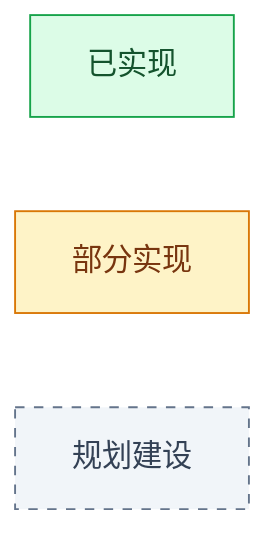

## 2. 系统详细架构图

```mermaid
flowchart TB
    U[用户]:::actor
    DEV[流程或 Agent 设计者]:::actor

    subgraph UI[交互层]
        CHAT[对话页面<br/>Agent Tool 侧边栏]:::done
        REWRITE_UI[短文改编交互<br/>风格选择与方向确认]:::done
        DAG_UI[Workflow 可视化画布<br/>节点配置与调试]:::planned
        RUN_UI[Run 轨迹与审批页面]:::planned
    end

    subgraph API[接入与 API 层]
        AI_API[AIController<br/>对话 SSE、上传与删除]:::done
        AGENT_API[AgentPlatformController<br/>能力、MCP、Agent Run]:::done
        DAG_API[DagWorkflowController<br/>校验、启动、查询]:::done
        RW_API[RewriteWorkflowController<br/>启动、选方向、查询]:::done
        MEM_API[Memory / Skill API]:::planned
    end

    subgraph APP[应用服务层]
        PAS[PlatformAgentService<br/>统一 Agent 门面]:::done
        CHAT_SVC[StreamingChatService<br/>对话结果流式输出]:::done
        FILE_SVC[FileStorageService<br/>上传文件生命周期]:::done
        REWRITE[RewriteWorkflowService<br/>短文改编专用编排]:::done
        DAG_SVC[DagWorkflowService<br/>DAG 编译与调度]:::done
        RUN_SVC[Run Service<br/>异步、暂停、恢复、取消]:::planned
        EVENT_SVC[Run Event Stream<br/>结构化 SSE 事件]:::planned
    end

    subgraph ORCH[核心编排层]
        AR[Agent Runtime<br/>模型决策—能力调用—观察循环]:::done
        WE[Workflow Engine<br/>拓扑调度、条件、映射、重试]:::done
        HITL[Human-in-the-loop<br/>审批与人工输入节点]:::partial
        CHECKPOINT[Checkpoint Manager<br/>断点与恢复]:::planned
        SKILL_MATCH[Skill Matcher<br/>相似流程匹配与自动触发]:::planned
        SKILL_LEARN[Skill Learning<br/>显式记录或重复 3 次形成候选]:::planned
    end

    subgraph INTEL[模型与上下文层]
        MODEL_GATE[Model Gateway<br/>模型提供商与角色路由]:::partial
        PROMPT[Prompt / Agent Definition<br/>系统规则与能力白名单]:::partial
        CONTEXT[Context Assembler<br/>消息、记忆、知识、预算组装]:::planned
        STRUCT[Structured Output<br/>Schema 校验与自动修复]:::partial
    end

    subgraph CAP[能力平台层]
        REG[Capability Registry<br/>统一能力目录]:::done
        PROVISION[Capability Provisioning<br/>MCP Tool 发现与注册]:::done
        ROUTER[Capability Invoker Registry<br/>按能力类型路由]:::done
        POLICY[Capability Policy Engine<br/>权限、风险、审批策略]:::partial
        LOCAL[Built-in Capability Invoker<br/>文件系统、Knowledge]:::done
        MCP_INV[MCP Invocation Service<br/>校验、安全、调用、错误归一化]:::done
        SKILL_INV[Skill Invocation Service]:::planned
        WF_INV[Workflow Capability Invoker]:::planned
        AGENT_INV[Sub-Agent Invoker]:::planned
        MEM_INV[Memory Capability Invoker]:::planned
    end

    subgraph MCP[MCP 基础设施]
        MCP_REG[MCP Server Registry<br/>合并与管理服务定义]:::done
        MCP_CONN[MCP Connection Manager<br/>连接复用、健康检查、重连]:::done
        STDIO[STDIO Client]:::done
        HTTP[Streamable HTTP Client]:::done
    end

    subgraph DATA[数据与知识层]
        RAG[RAG Service<br/>切分、向量化、检索]:::done
        UPLOAD[(上传文件)]:::done
        EMBED[(Embedding Store<br/>当前 Redis 持久化与内存索引)]:::partial
        REDIS[(Redis<br/>工作流状态、缓存、向量数据)]:::done
        RUN_DB[(Run / Event / Checkpoint Store)]:::planned
        DEF_DB[(Agent / Workflow / Skill Version Store)]:::planned
        MEMORY[(Memory Store<br/>会话摘要、偏好、经历、向量)]:::planned
    end

    subgraph EXT[外部运行资源]
        LLMS[OpenAI / Ollama / 智谱<br/>OpenAI-compatible Models]:::done
        GITHUB[GitHub MCP Server]:::done
        FETCH[Fetch MCP Server]:::done
        SEARCH[Search MCP Server]:::partial
        OTHER[其他本地或远程 MCP Server]:::done
        DOCLING[Docling 文档解析器]:::done
    end

    U --> CHAT
    U --> REWRITE_UI
    DEV --> DAG_UI
    DEV --> RUN_UI
    CHAT --> AI_API
    REWRITE_UI --> RW_API
    DAG_UI --> DAG_API
    RUN_UI --> AGENT_API

    AI_API --> CHAT_SVC --> PAS
    AI_API --> FILE_SVC
    AGENT_API --> AR
    DAG_API --> DAG_SVC --> WE
    RW_API --> REWRITE
    MEM_API --> SKILL_LEARN

    PAS --> AR
    REWRITE --> MODEL_GATE
    REWRITE --> MCP_INV
    REWRITE --> HITL
    WE --> AR
    WE --> MCP_INV
    WE --> HITL
    WE --> CHECKPOINT
    RUN_SVC --> AR
    RUN_SVC --> WE
    RUN_SVC --> EVENT_SVC

    AR --> PROMPT
    AR --> MODEL_GATE
    AR --> REG
    AR --> ROUTER
    AR -.上下文.-> CONTEXT
    MODEL_GATE --> STRUCT
    MODEL_GATE --> LLMS

    REG <--> PROVISION
    ROUTER --> LOCAL
    ROUTER --> MCP_INV
    ROUTER -.-> SKILL_INV
    ROUTER -.-> WF_INV
    ROUTER -.-> AGENT_INV
    ROUTER -.-> MEM_INV
    POLICY --> ROUTER

    MCP_INV --> MCP_REG
    MCP_INV --> MCP_CONN
    MCP_CONN --> STDIO
    MCP_CONN --> HTTP
    STDIO --> GITHUB
    STDIO --> FETCH
    STDIO --> SEARCH
    STDIO --> OTHER
    HTTP --> OTHER

    LOCAL --> RAG
    FILE_SVC --> UPLOAD
    FILE_SVC --> RAG
    RAG --> EMBED
    RAG --> DOCLING
    EMBED --> REDIS
    REWRITE --> REDIS
    WE --> REDIS
    RUN_SVC -.-> RUN_DB
    PROMPT -.-> DEF_DB
    SKILL_LEARN -.-> DEF_DB
    SKILL_MATCH -.-> DEF_DB
    CONTEXT -.-> MEMORY
    MEM_INV -.-> MEMORY

    SKILL_MATCH -.匹配后作为高层能力.-> REG
    SKILL_LEARN -.成功轨迹抽象.-> SKILL_MATCH

    classDef actor fill:#ede9fe,stroke:#7c3aed,color:#4c1d95
    classDef done fill:#dcfce7,stroke:#16a34a,color:#14532d
    classDef partial fill:#fef3c7,stroke:#d97706,color:#78350f
    classDef planned fill:#f1f5f9,stroke:#64748b,color:#334155,stroke-dasharray: 5 5
```

### 各层职责

| 层级 | 主要职责 | 关键原则 |
|---|---|---|
| 交互层 | 对话、选择 Agent Tool、上传文件、选择改编方向、查看运行轨迹 | UI 不直接调用模型或 MCP |
| 接入层 | 参数校验、创建 Run、查询状态、SSE 推送 | API 与执行生命周期分离 |
| 应用服务层 | 把具体业务请求转换为 Agent 或 Workflow 请求 | 业务不直接依赖具体 MCP 客户端 |
| 核心编排层 | 自主决策或确定性编排、人工节点、暂停恢复 | Agent 与 Workflow 可互相组合但职责不同 |
| 模型与上下文层 | 模型路由、Prompt、结构化输出、上下文预算 | 模型只看见获授权的能力 |
| 能力平台层 | 能力注册、发现、路由、策略、执行 | Capability 是统一契约，Tool 只是其中一种实现 |
| MCP 基础设施 | MCP 服务配置、连接、发现 Tools、标准调用 | 模型不直接连接 MCP Server |
| 数据与知识层 | 文件、向量、运行轨迹、定义版本、Memory | 原始资料、运行状态和长期记忆分开存储 |

## 3. Agent 自主调用 Tool / Knowledge 数据流图

该路径适用于普通对话、网页读取、GitHub 查询、只读文件系统以及用户上传文档问答。

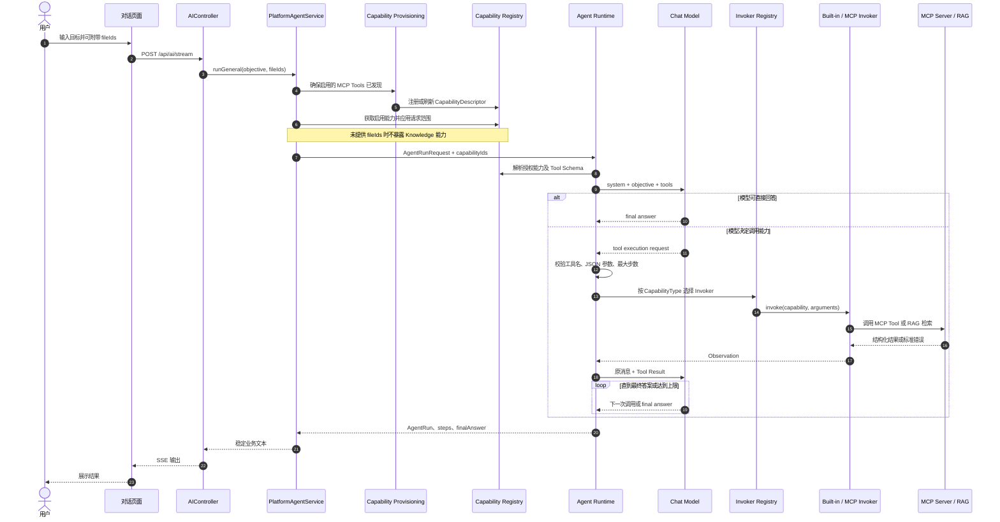

### 自主调用的关键约束

- 模型只负责“选择哪个能力、传什么参数”，不负责建立 MCP 连接。
- Agent Runtime 只暴露 `AgentDefinition.capabilityIds` 白名单中的工具。
- Capability Registry 提供工具名、说明、输入 Schema、提供方和操作名。
- MCP Invocation Service 在实际调用前再次执行 Schema、安全域名和仓库范围校验。
- Knowledge 不是普通网页搜索；它只允许检索本次请求明确授权的 `fileIds`。
- MCP/Knowledge 返回内容作为不可信 Observation，不能覆盖系统提示词。

## 4. 通用 DAG Workflow 数据流图

该路径适用于确定步骤、条件分支、多模型接力、失败重试和未来人工审批场景。

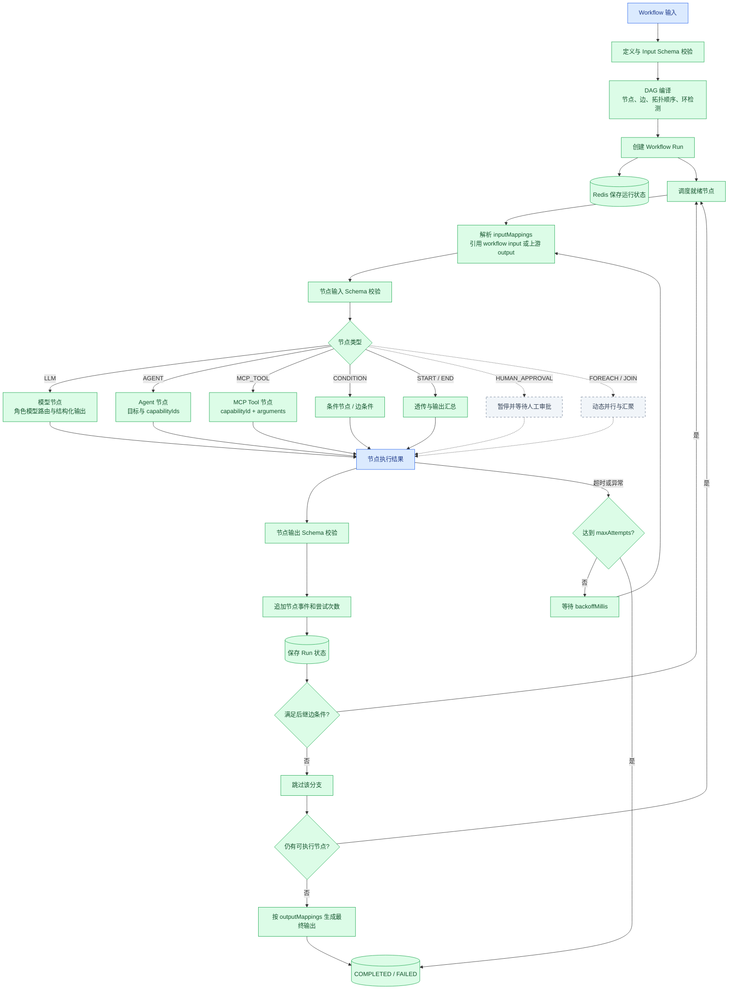

### 当前支持的节点

| 节点 | 作用 | 输入来源 | 输出 |
|---|---|---|---|
| `START` | 接收并透传工作流输入 | Workflow input | 初始上下文 |
| `LLM` | 单次模型处理，适合分析、分类、生成结构化 JSON | 常量或上游输出 | 文本或 JSON |
| `AGENT` | 运行多轮自主 Agent，可在节点内部调用多个能力 | objective、节点输入、capabilityIds | 完整 AgentRun |
| `MCP_TOOL` | 确定性调用某个 MCP Capability | capabilityId 与参数 | Tool 结果 |
| `CONDITION` | 计算或承接分支条件 | 上游输出 | 条件结果 |
| `END` | 汇总最终输出 | 前序节点输出 | Workflow output |

## 5. 短文改编专用工作流数据流图

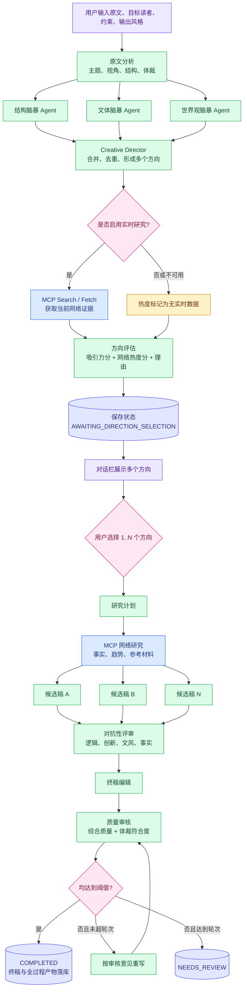

## 6. 系统用例图

Mermaid 没有标准 UML Use Case 图类型，下面使用等价的参与者—用例关系表达。

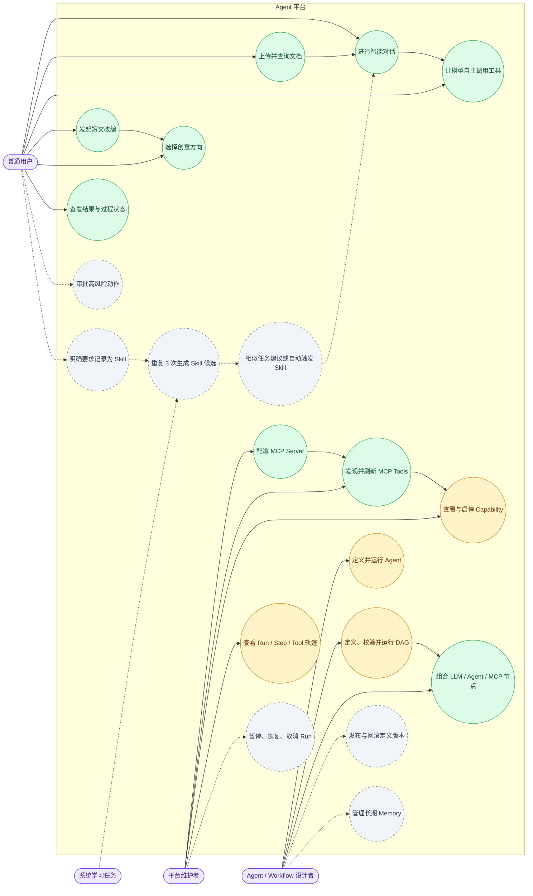

## 7. Capability 与 Tools 说明图

### 7.1 统一能力模型

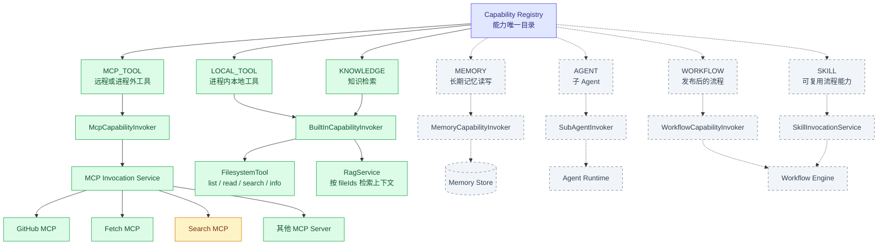

### 7.2 Capability、Tool、MCP、Knowledge、Memory、Skill 的关系

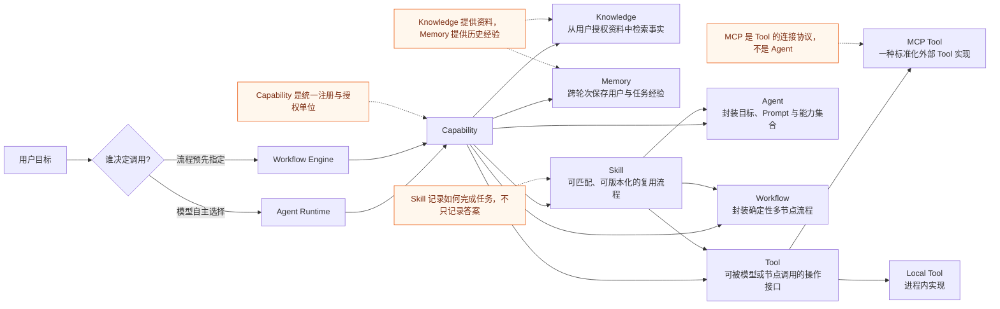

### 7.3 当前能力清单

| Capability / Tool | 类型 | 当前状态 | 作用 | 主要安全边界 |
|---|---|---|---|---|
| `local.filesystem.list_directory` | LOCAL_TOOL | 已实现 | 列出允许目录 | 只能访问 `allowed-roots` |
| `local.filesystem.read_file` | LOCAL_TOOL | 已实现 | 读取允许目录中的文本文件 | 文件大小与路径限制 |
| `local.filesystem.search_files` | LOCAL_TOOL | 已实现 | 按文件名关键字搜索 | 深度和结果数限制 |
| `local.filesystem.info` | LOCAL_TOOL | 已实现 | 查询允许目录磁盘信息 | 只读 |
| `knowledge.rag.answer` | KNOWLEDGE | 已实现 | 检索用户本次授权的上传文档 | 必须传入当前请求的 `fileIds` |
| `mcp.github.*` | MCP_TOOL | 已实现，需 Token | 查询仓库、Issue、提交等 | 仓库白名单、密钥不进入模型上下文 |
| `mcp.fetch.*` | MCP_TOOL | 已实现，需本地服务 | 读取明确 URL 内容 | 域名白名单、响应长度限制 |
| `mcp.rewrite-search.*` | MCP_TOOL | 条件实现 | 为方向热度和改编研究提供实时搜索 | 搜索服务需单独配置 |
| `mcp.<server>.*` | MCP_TOOL | 已实现 | 动态发现任意 STDIO / HTTP MCP Tools | Schema 校验、连接与错误归一化 |
| `memory.*` | MEMORY | 规划建设 | 检索、写入、纠正长期记忆 | 隐私范围、来源、置信度、可删除 |
| `agent.<id>` | AGENT | 规划建设 | 把专用 Agent 作为高层能力调用 | 最大嵌套深度、循环检测、能力继承限制 |
| `workflow.<id>` | WORKFLOW | 规划建设 | 把已发布 Workflow 作为能力调用 | 固定版本、输入输出 Schema、超时 |
| `skill.<id>` | SKILL | 规划建设 | 对相似任务建议或自动执行复用流程 | 风险级别、匹配阈值、用户确认、版本 |

### 7.4 一个 Capability 应包含的元数据

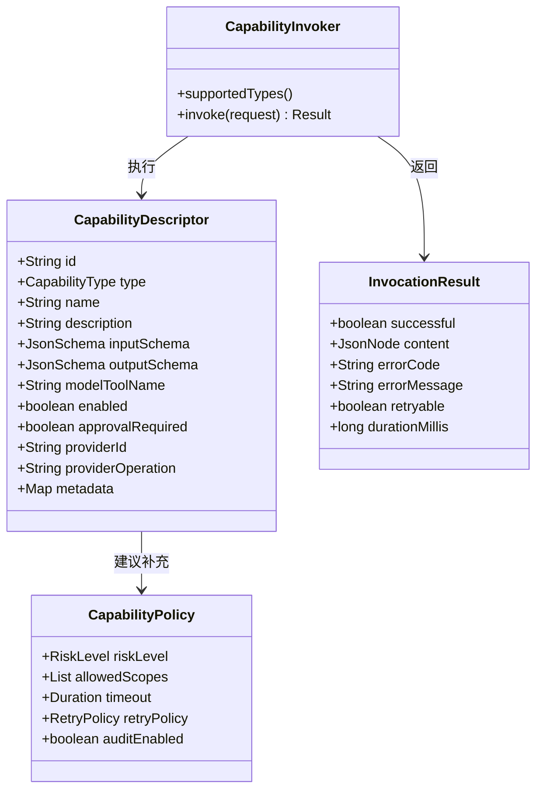

## 8. Memory 与 Skill 在架构中的位置

Memory 与 Skill 不能合并：

- **Memory** 保存“用户是谁、曾发生什么、偏好什么、上次进行到哪里”。
- **Skill** 保存“面对某类输入，应按什么步骤、调用哪些能力、得到什么结构的输出”。

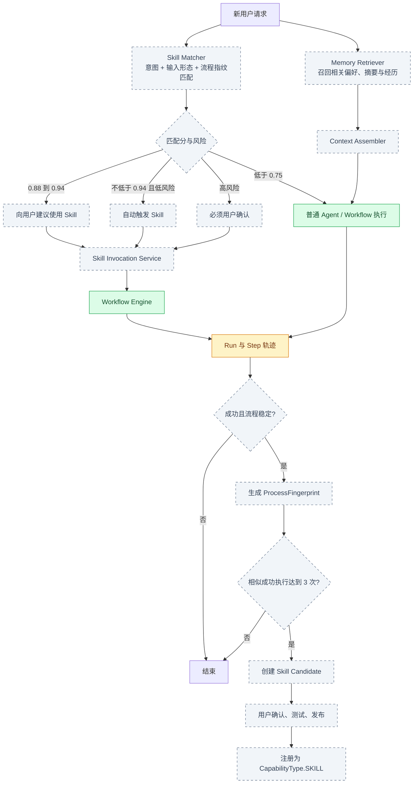

## 9. 建议的核心数据对象

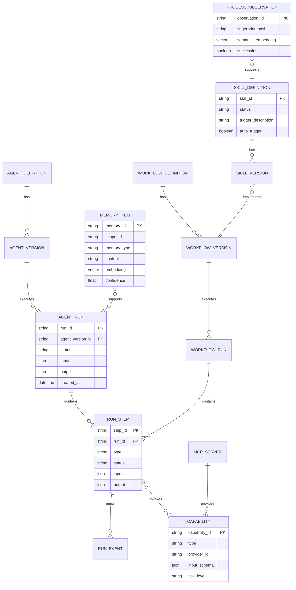

对于当前非商用单体应用，可以继续使用 Redis 保存短期 Run 状态；当开始建设可恢复执行、长期 Memory、Skill 版本和复杂查询时，建议引入 PostgreSQL + pgvector，并保留 Redis 负责缓存、分布式锁和短生命周期状态。

## 10. 当前实现与目标架构差距

| 优先级 | 建设项 | 当前状态 | 完成标准 |
|---|---|---|---|
| P0 | Agent Run 持久化与异步生命周期 | 同步执行，步骤随响应返回 | 可创建、查询、取消、失败恢复，Run/Step/Event 可持久化 |
| P0 | 结构化事件流 | 对话只输出最终文本，工作流轮询状态 | SSE 推送 run、model、tool、approval、final 等类型事件 |
| P0 | Checkpoint 与人工审批 | 改编方向选择已有专用实现 | 通用 Workflow/Agent 可暂停、审批、恢复且不重复已完成节点 |
| P0 | Capability Policy Engine | 已有部分 Fetch/GitHub/文件安全规则 | 统一风险等级、作用域、审批、超时、重试和审计策略 |
| P1 | Agent/Workflow 定义与版本库 | DAG 定义随请求提交 | 可草稿、测试、发布、固定版本运行、回滚 |
| P1 | Memory System | 尚未实现 | 会话摘要、偏好、经历提取、混合检索、纠正与删除 |
| P1 | Skill System | 尚未实现 | 显式记录、3 次候选、匹配建议、低风险自动触发、版本化 |
| P1 | Workflow 可视化编辑器 | 尚未实现 | 拖拽节点、连线、Schema 映射、条件配置、调试运行 |
| P1 | Model Gateway 完整化 | 已有 provider 与角色路由 | 统一模型能力、限流、故障回退、成本/Token 统计、结构化输出 |
| P2 | 动态并行节点 | 固定 DAG 节点 | 支持 FOREACH、JOIN、子流程与并发限制 |
| P2 | Eval 与回归测试 | 以单元测试为主 | Agent、Workflow、Tool 与 Prompt 的数据集评测和版本对比 |
| P2 | 可观测性 | 有日志与部分事件 | Trace、指标、错误聚合、工具耗时和模型 Token 视图 |

## 11. 推荐建设顺序

```mermaid
flowchart LR
    P01[P0-1<br/>Run / Step / Event 持久化] --> P02[P0-2<br/>异步执行与结构化 SSE]
    P02 --> P03[P0-3<br/>Checkpoint / Pause / Resume / Cancel]
    P03 --> P04[P0-4<br/>统一审批与 Capability Policy]
    P04 --> P11[P1-1<br/>Agent / Workflow 版本库]
    P11 --> P12[P1-2<br/>Memory System]
    P12 --> P13[P1-3<br/>Skill 显式记录]
    P13 --> P14[P1-4<br/>重复 3 次形成候选与相似触发]
    P14 --> P15[P1-5<br/>Workflow 可视化画布]
    P15 --> P21[P2<br/>Eval、观测、动态并行与子流程]
```

这条顺序优先补齐“任务不会丢、过程看得见、风险能暂停”，再建设 Memory 和 Skill。否则 Skill 自动触发后很难解释它为什么执行、执行到了哪里，也无法安全恢复。

