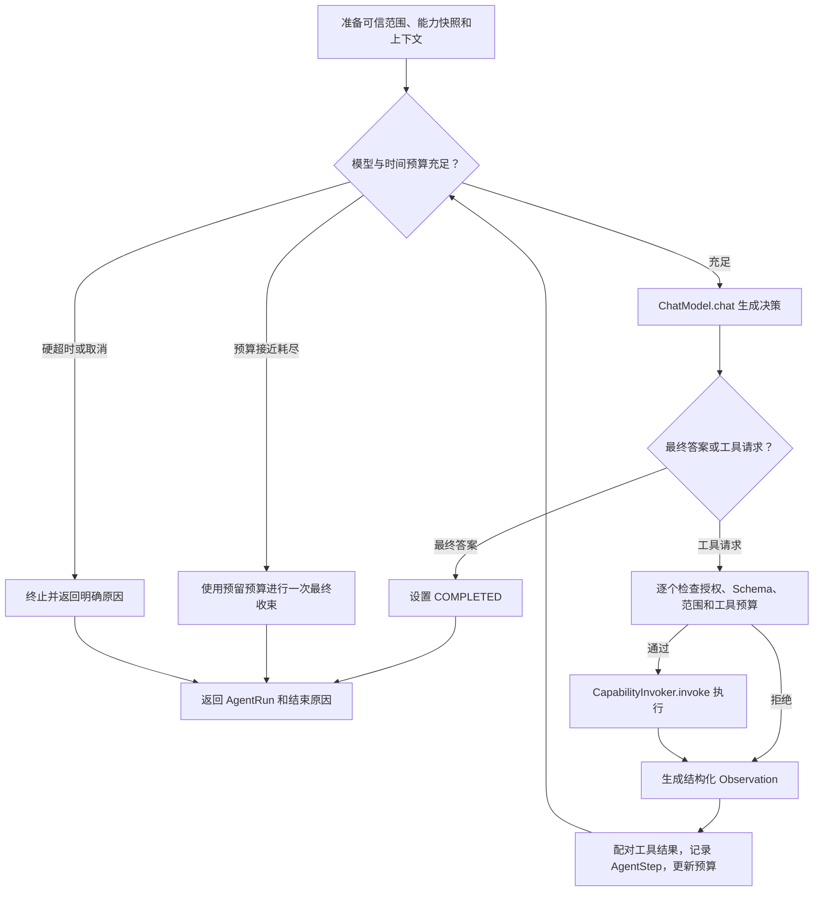

# 当前平台的 ReAct 执行机制设计

这里的 ReAct 指 Agent 的推理、行动和观察循环。建议在现有 `DefaultAgentRuntime` 上演进，使用模型的原生工具调用表达行动，由 Runtime 控制授权、执行、观察回填和终止。原始 ReAct 方法将推理与环境交互交替进行，使后续决策能利用行动取得的信息。 [ReAct 论文](https://arxiv.org/abs/2210.03629)

当前阶段的设计范围是六模块中的执行能力。聊天和 DAG 继续通过同一个 Runtime 获得一致的执行语义。

2026-11-11 已落地第一阶段，包括时间与次数预算、一次额外最终收束、重复结果检测，以及从模型工具请求到 MCP 的调用 ID 关联。下表保留改造前的基线，具体配置和当前结果语义见 [运行说明](../../README.md)。上下文裁剪及 SSE 进度事件属于后续阶段。

| 改造前基线 | 设计判断 |
| --- | --- |
| `execute()` 将系统规则、记忆资料、历史和当前目标加入模型消息 | 沿用消息分层，在模型输入预算中统一管理各部分长度 |
| `ChatModel.chat()` 返回 `AiMessage`，通过 `ToolExecutionRequest` 表达工具调用 | 沿用结构化调用，以工具参数和观察结果记录执行过程 |
| `invokeCapability()` 校验参数与范围，再调用 `CapabilityInvoker` | 保留统一调用关口，补齐调用预算、超时与副作用策略 |
| `ToolExecutionResultMessage` 回填模型，`AgentStep` 记录步骤 | 补充模型轮次、工具调用 ID、终止原因和结果长度信息 |
| `maxSteps` 默认 8、最大 30，计数对象是模型调用轮次 | 将模型轮次与工具调用次数分别计数，保留对原配置的兼容映射 |
| 达到最后模型轮次时仍会执行该轮工具，然后返回步数耗尽 | 在执行工具前核验预算，并为最终收束单独预留模型调用和时间 |
| `approvalRequired` 返回 `AWAITING_APPROVAL`，当前聊天和 DAG 将未完成状态作为失败处理 | 首期以现有只读能力形成完整闭环，写操作接入前完成审批、幂等和恢复契约 |
| MCP 发现目前将工具注册为启用且无需审批，通用聊天会纳入当前启用的 MCP 能力 | 在发现后明确读写属性和可用策略，普通聊天仅装配获准的能力集合 |

源码入口为 [Runtime 循环](../../openmanus-runtime/src/main/java/com/melon/agent/runtime/DefaultAgentRuntime.java)、[预算配置](../../openmanus-runtime/src/main/java/com/melon/config/properties/AgentRuntimeProperties.java) 和 [能力调用契约](../../openmanus-runtime/src/main/java/com/melon/agent/runtime/CapabilityInvocation.java)。

建议的执行状态转换如下。图中阶段描述一次运行内部的执行位置，`AgentRun.Status` 继续表达整次运行的状态。

模型负责根据当前目标和观察结果选择行动。Runtime 持有可执行能力白名单，执行前再次核验该能力仍然启用、参数合法且资源范围属于本轮授权。工具输出作为数据加入模型消息，已有的系统规则和访问范围继续由服务端控制。模型返回的正文可作为行动说明或最终答案展示，日志围绕实际调用、结果、耗时与错误展开。

执行方法可逐步收敛为以下职责，适合在现有类中先用私有方法落地。

| 方法职责 | 输入与输出 |
| --- | --- |
| 准备执行上下文 | 将 `AgentRunRequest` 转为本轮消息、能力描述快照、可信资源范围和预算计数器 |
| 请求模型决策 | 调用 `ChatModel.chat()`，校验响应并记录模型轮次与用量 |
| 执行工具批次 | 沿用 `invokeCapability()`，对每次调用分别检查剩余预算和策略 |
| 回填观察 | 沿用 `observation()` 和 `ToolExecutionResultMessage.from()`，限制正文大小并保留调用配对 |
| 判断终止和收束 | 区分最终答案、轮次耗尽、工具上限、硬超时、取消及重复失败 |

预算至少包含 `maxModelRounds`、`maxToolCalls`、`maxToolCallsPerRound`、`maxRunDuration`、`maxToolDuration` 和 `maxObservationSize`。每次模型请求和每次工具执行前都检查剩余额度。模型与远程调用的实际超时取各自配置和运行剩余时间的较小值。线程等待超时只代表本地等待结束，远端执行需要按连接支持的取消能力处理，写操作仍需幂等保护。

为最终收束预留一次模型调用及对应时间。接近行动预算上限时，先结束当前工具批次的结果配对，再关闭工具选择，要求模型根据已有观察给出答案或说明尚未完成的部分。硬超时、取消或模型未能生成有效收束结果时，以明确原因终止。前端可以据此区分执行失败与业务信息不足。现有会话保存继续以 Runtime 的完成结果为准，普通 SSE 的最终文本在事务保存之后发送。

一条 `AiMessage` 可能包含多个工具请求。默认沿用串行执行，逐个记录 `toolCallId`。每个请求都应有对应结果，包括因预算或授权被跳过的请求，再进入下一轮模型调用或收束。并发优化限定在声明为只读且相互独立的调用，并保留结果和原始调用 ID 的对应关系。

建议扩展现有调用结果封装，使模型能根据错误类型调整行动。当前 `CapabilityInvocation.Result` 已有 `retryable`，而 `observation()` 尚未将该字段回填模型。新增字段应通过兼容构造方式或默认值逐步迁移。

| Observation 信息 | 用途 |
| --- | --- |
| `successful`、`content` | 告知工具实际执行状态和受限结果正文 |
| `errorCode`、`errorMessage`、`retryable` | 区分参数错误、越界、短暂故障和业务拒绝，支持选择下一步行动 |
| `truncated`、来源标识 | 告知正文被截断以及可继续读取的资源或来源 |
| 调用 ID、耗时 | 与 `AgentStep` 关联，供调试和用量评估 |

重试由平台决定是否允许。参数错误返回 Observation，让模型修正参数。只读操作的短暂网络故障可在剩余预算内有限重试。含副作用的操作通过独立的业务幂等键标识同一次逻辑操作，网络超时后先确认执行状态。模型产生新的工具调用 ID 时，仍需识别它是否在重复同一次业务操作。

在单次 Run 中记录能力 ID、归一化参数和结果状态的摘要。相同调用持续返回相同失败或没有新增信息时，触发重复调用上限，要求调整方案或收束。将真实执行的每次重试计入总工具预算，避免 SDK 重试、平台重试和模型重试叠加失控。

上下文预算按模型可用输入量分配。优先保留系统规则、当前问题、可信范围以及当前工具消息批次。旧工具结果可缩减为状态、关键数据和来源，旧历史可使用已保存的摘录。裁剪时将一个工具请求及其全部对应结果作为整体处理。记忆和知识内容保留来源及数据身份，避免把外部资料中的指令当作执行策略。

模块职责沿用现有结构。

| 模块 | ReAct 相关职责 |
| --- | --- |
| `openmanus-runtime` | 决策循环、预算、终止、可信范围、调用配对、Observation 和执行步骤 |
| `openmanus-tools` | MCP 与本地工具执行、安全策略、连接超时及工具副作用契约 |
| `openmanus-context` | 会话历史、运行前记忆召回、知识与附件检索，以及成功问答保存 |
| `openmanus-model` | 模型构造、模型能力和 Token 用量支持 |
| `openmanus-workflow` | 将 Agent 作为节点调用，并消费 AgentRun 结果 |
| `openmanus-app` | 聊天入口、调用范围装配、最终 SSE 和后续执行事件展示 |

确定性的选库问答继续由 `KnowledgeChatService.answer()` 执行。通用 ReAct Agent 的附件检索、MCP 和记忆能力由现有能力目录提供。工具描述需明确用途、输入约束和输出含义，模型据此选择能力。

建议按三步推进。先补齐模型与工具预算、最终收束、重复调用检测及 `toolCallId`，用聊天和 DAG 两个入口回归同一个 Agent。再补结果长度控制、上下文裁剪与结构化错误，验证工具失败后能够调整行动。最后通过 Runtime 的执行事件回调向 App 提供模型调用、工具开始、工具完成和最终结果，使 SSE 能展示当前执行进度。

关键回归场景包括直接回答、工具后回答、同轮多工具、参数修正、工具越界、重复失败、最后一轮仍请求工具、硬超时，以及历史工具消息裁剪后的调用配对。普通对话的现有方法时序见 [对话用例与时序](conversation-method-use-cases.md)。
