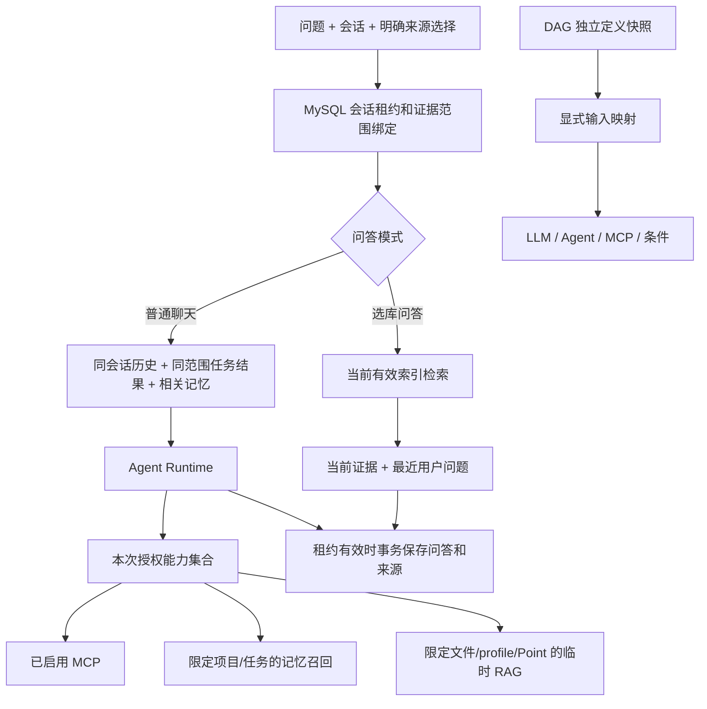

# 功能、设计和数据隔离复核（2026-11-04）

本次核对当前调用入口、数据归属和共享状态，检查跨会话、项目、任务、知识库、附件、向量版本和运行实例的串用。结论区分已修复问题与未闭环限制，不代表多用户权限或所有并发场景已完成验证。

## 功能与数据归属

| 功能 | 入口 / 执行 | 事实源 | 必须限定的范围 |
|---|---|---|---|
| 普通聊天 | `/api/memory/chat` → Runtime | MySQL 会话/消息 | 会话、项目、任务、固定来源 |
| 旧客户端 | `/api/ai/stream` | 本次运行消息 | 无会话保存，不能误认为已接入历史 |
| Knowledge | `/api/knowledge` | MySQL 元数据/版本/分块、MinIO 原件、Qdrant 索引 | knowledge 域、库/文件、有效索引、模型版本 |
| 临时附件 | 上传接口 → RagService | Redis 元数据、MinIO、Qdrant | temporary 域、文件、profile、当前 Point ID |
| 会话/任务记忆 | MemoryChatService | MySQL 消息、摘录、进展、最近结果及来源绑定 | 会话、任务、证据范围、来源会话 |
| 长期/项目/任务记忆 | MemoryService / memory.recall | MySQL 正文/修订、Qdrant | memory 域、local/项目/任务、修订、模型版本 |
| Agent | Runtime / Capability Registry | 本次运行的模型消息、工具观察、步骤 | 新建消息列表、能力白名单、服务端限定范围 |
| MCP | Invocation / Connection Manager | 共享工具目录、按服务缓存的连接 | 类型、提供方、唯一工具名、启用状态 |
| DAG | 可视化画布 / DAG Engine | Redis 定义和运行快照 | runId、独立定义快照、显式输入映射、页面请求版本 |
| 短文改编 | RewriteWorkflow | Redis 状态、方向选择、稿件 | workflowId、用户方向和输出文体；不隐式读普通会话 |
| 图片/视频展示 | 聊天渲染 / 内容下载 | 文件 URL、MinIO | 展示能力不等于已接入图像/视频生成模型 |

共享基础设施不意味着共享上下文。用户明确记录的 local 长期记忆是全局范围，相关内容跨项目召回属于设计行为；项目/任务记忆不能自动提升为全局记忆。

## 确认并修复的问题

| 优先级 | 问题及影响 | 修复 |
|---|---|---|
| 高 | 同一会话换知识库/附件后，旧回答和摘录继续进入模型 | 首次执行固定来源范围；变化返回 409，需新会话；未知来源的旧会话保留查看，不继承历史 |
| 高 | 任务最近结果无来源，可从库 A 流入库 B/普通聊天 | 记录来源范围和会话，仅同范围可注入 |
| 高 | 删除会话后任务结果仍残留 | 清空该来源会话对应的当前任务结果，级联删除来源记录，不清除其他会话后来写入的结果 |
| 高 | Knowledge 旧助手答案和 Memory 可能复活旧版本/已删除文档事实 | 当前检索资料作为证据；历史只保留最近三个用户问题解释指代，不注入旧助手答案和 Memory 正文 |
| 高 | 最近四条任意记忆无条件注入所有问题 | 仅注入范围内相关召回；任务人工状态/进展独立保留 |
| 高 | 记忆正文放入 SystemMessage，提升不可信资料的指令层级 | 改用资料性质的 UserMessage，系统规则独立 |
| 高 | 项目聊天的二次记忆工具调用丢失项目/任务范围 | 从服务端会话传入 memoryProjectId/memoryTaskId，覆盖模型自行指定的范围 |
| 高 | 同名内置提供方阻止 MCP 发现，或被当成 MCP 能力返回/删除 | 发现和结果均检查 MCP_TOOL 类型，MCP 刷新不删除同名内置能力 |
| 高 | 注册冲突已破坏旧索引，刷新存在空窗/半成品 | 冲突预检，完整候选目录验证后原子提交，读写使用同一锁 |
| 中 | 陈旧 MCP 能力仍进入通用 Agent | 仅暴露本次已启用提供方返回的 MCP 能力集合 |
| 中 | 临时 RAG 只按 file_id 过滤/删除 | 增加 temporary 域、profile、当前 Point ID 和读取后元数据检查；Knowledge 删除也限定 knowledge 域 |
| 中 | 缺失附件静默跳过，解析失败可能继续用旧向量 | 附件缺失、失败或索引变化时终止该附件问答 |
| 中 | 切项目/会话时附件、知识库选择残留，晚到上传进入新页面 | 切换时解除暂存选择，上传结果检查页面范围版本 |
| 中 | 清理附件后清空全局数组，误移除后来文件 | 清理本轮快照，仅移除后端确认成功的 ID |
| 中 | 中断立即解锁，旧 finally 清掉新 controller | 等本次 finally 结束再解锁；回答期间锁定知识库选择 |
| 中 | 旧 DAG 轮询、加载、校验、保存响应覆盖新页面 | 设计和轮询版本检查，阻止重叠轮询和旧定时器重启 |
| 中 | DAG 定义快照与调用方共享可变对象 | 执行前复制，编译和运行使用独立快照 |
| 中 | 慢向量同步占用租约心跳调度线程 | Memory 使用独立索引调度器和聊天线程池；出队检查租约和连接状态 |
| 中 | 完整模型日志混存记忆、知识和问题正文 | 关闭相关模型请求/响应日志，常规日志仅保留长度和状态 |

## 收紧后的设计

## 尚未闭环的限制

1. **来源切换体验**：换库/附件需新建会话；尚未按每条消息追踪来源并在同一会话裁剪历史。旧会话正文保留；恢复选库会话需要重选原库集合。
2. **偏好与事实分类**：没有 RULE/PREFERENCE/FACT 类型。相关性召回可能漏掉通用偏好或误召回事实，需增加适用范围、优先级和质量评测。
3. **彻底遗忘**：删记忆不会擦除所有提及该事实的历史消息；删会话不会删除用户另外明确保存的记忆。完整遗忘需要派生关系与删除范围设计。
4. **临时附件一致性**：Redis 元数据和浏览器清理尚无 MySQL Outbox/定期对账。进程退出、跨实例重复索引、解析/删除竞态可留下不可见的孤立 Point/对象。新过滤阻止正常召回，但未扫描清除 legacy Point。
5. **运行取消与副作用**：SSE 中断不等于远端调用取消；DAG 超时/重试不能回滚外部写操作。需取消令牌、工具幂等键和按能力控制重试。
6. **MCP 自身状态**：连接按服务共享。第三方 Server 若保存工作目录或会话变量，需服务级隔离策略或每次运行独立会话，平台请求 ID 本身不能隔离它。
7. **统一任务**：Memory 任务与 Redis DAG/改编运行未统一；通用崩溃恢复未闭环。
8. **单用户边界**：没有账号级 ownership/ACL。项目范围防串用不等于多用户授权。
9. **容量隔离**：仍共享 MySQL/Qdrant/Embedding/MinIO；有界线程池减少阻塞，但尚无按功能限流和容量配额。

## 验证与范围

- 真实 MySQL/Qdrant：证据范围绑定、跨项目/任务隔离、修订拒绝、结果来源及删除、向量清理、租约竞争与恢复。
- 可控模型：Knowledge 不接纳旧助手答案/Memory 为证据；Runtime 使用服务端记忆范围。
- 内存向量对抗样本：相同 file_id 的不同域、旧 profile 不串读；临时删除保留 Knowledge/Memory。
- 目录：冲突回滚、刷新原子性、同名提供方类型隔离、陈旧工具筛除。
- DAG：定义修改不影响 Run 快照；延迟轮询不能覆盖新页面或重启旧定时器；页面脚本语法检查。
- Knowledge 的 MinIO 联调本次未启用：上一轮已确认当前 MinIO 无法连接，不将该项算作通过。浏览器交互尚未验收。

命令：`mvn -o -Dmemory.integration=true -Dmysql.integration=true -Dqdrant.integration=true test`。

本次结果：55 项中 54 项通过、1 项跳过，失败和错误均为 0。前端竞态测试：`node --test src/test/js/workflow-isolation.test.cjs`。
