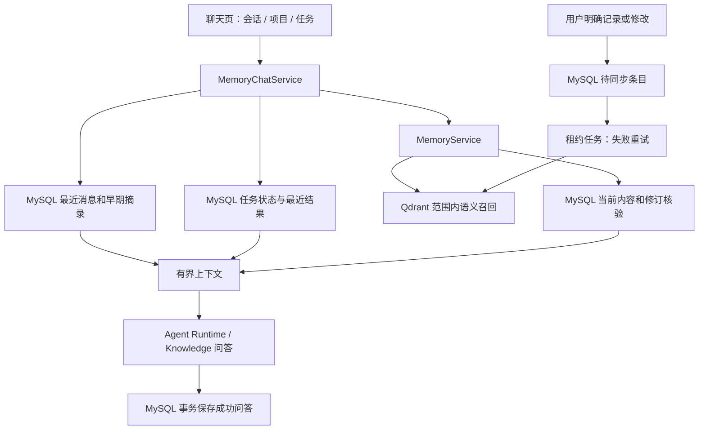

# Memory 第一版：MySQL + Qdrant

本版面向当前单用户平台，复用 `knowledge.datasource` 指向的物理 MySQL 数据源，以及现有 Qdrant Collection 和 Embedding 配置。不会创建第二套数据库连接或使用本地文件存储记忆。

## 能力与存储

| 范围 | 已实现 | 存储 |
|---|---|---|
| 会话 | 创建、切换、删除，消息历史恢复；普通问答和知识库问答自动加载历史 | MySQL conversation/message |
| 任务 | 项目下或独立任务，状态、用户维护的进展、最近成功问答结果；可跨会话接续 | MySQL task + TASK 记忆 |
| 长期 | 用户明确记录、修改、删除，语义召回与词项匹配兜底 | MySQL entry + Qdrant |
| 项目 | 项目定义，项目内会话/任务和独立项目记忆；进入项目后加载规则与相关记忆 | MySQL project/entry + Qdrant |

`la4j_mem_*` 表是事实源，记录无自动过期时间。当前未接入账号系统，LONG_TERM 的范围固定为 `local`；范围校验用于防止不同项目/任务混用，不等同于多用户授权。

2026-11-04 隔离复核：会话首次执行固定知识库/附件范围，改变范围需新建会话。没有来源绑定的旧会话保留查看，不能自动继承未知历史。任务结果增加范围和来源会话追踪；删除来源会话会清空对应的当前结果。完整说明见 [数据隔离复核](data-isolation-audit.md)。

Qdrant 与 Knowledge 共用 Collection，但使用 `scope=memory`、`owner=local`、`memory_scope`、`scope_id`、`memory_id`、`revision`、`embedding_version` 隔离。向量载荷只保存标识，不存记忆正文。召回后必须回查 MySQL 验证删除标记、范围和修订号；知识库检索及临时附件检索保持各自过滤规则。

## 使用

重启后打开 `/chat`，侧边栏 Memory 面板支持：

1. 选择/新建项目，选择/新建任务，也可使用独立会话。
2. 发送消息时自动创建会话；普通智能问答的一问一答成功后自动保存，刷新后可选择原会话恢复。
3. 展开记忆管理，选择长期、项目或任务范围，明确输入要记录的偏好、事实或约束并点击“记录”。
4. 修改和删除记忆；查看向量同步状态，模型或 Collection 变化时点击“重建索引”。
5. 更新任务状态与进展；成功回答只更新独立的“最近结果”，不会覆盖人工维护的进展。

颠覆性改编仍使用原独立工作流，不会自动将改编事件保存为普通聊天消息。取消浏览器请求表示停止接收；已开始的模型执行可能仍完成并保存结果，刷新会话可查看。聊天失败不保存本轮问答。

## 数据流与一致性



- 同一会话使用 90 秒租约，每 20 秒续租；并发请求返回 409。崩溃后租约过期可重试，旧执行不能保存答案。
- 历史选择最近 12 条，每条最多 4000 字、总计最多 16000 字。更早消息逐步转成最长 6000 字的原始摘录，不调用模型编造摘要。完整消息仍在 MySQL，可用分页 API 获取。
- 普通聊天只加载范围内最多六条相关记忆，不再无条件注入最近四条任意事实；单条最多 1200 字，记忆上下文总计最多 14000 字。资料以 UserMessage 提供，不能覆盖系统规则或当前用户要求。严格选库问答仅保留最近三个用户问题解释指代，知识事实来自本轮来源，不注入旧助手答案、摘要或 Memory 正文。
- 最近任务结果最多 6000 字。当前使用字符预算，未实现模型专属 Token 预算或语义摘要。
- 修改采用 `revision` 乐观锁；删除立即清空正文并隐藏条目，后台清除向量。MySQL 与 Qdrant 使用最终一致性，不宣称跨系统事务。
- 向量同步每 5 秒扫描待办，单条租约 5 分钟，失败 60 秒后重试。切换 Collection 后重建会清理旧 Collection 中该记忆的向量。
- Embedding 指纹包含提供方、地址、模型和现有 Knowledge 修订号。旧指纹向量不参与召回，可从 MySQL 词项匹配并手动重建。
- Qdrant/Embedding 故障时回退 MySQL 中文双字片段/英文词项匹配，`recall` 返回明确 warnings；此兜底不是语义检索。

## API

| 方法 | 路径 | 用途 |
|---|---|---|
| GET/POST | `/api/memory/projects` | 列出/创建项目 |
| GET/POST | `/api/memory/tasks` | 按 projectId 列任务/创建任务 |
| PATCH | `/api/memory/tasks/{id}` | `{status,progress}` 更新任务 |
| GET/POST | `/api/memory/conversations` | 按 projectId 列会话/创建 `{projectId,taskId,title}` |
| GET | `/api/memory/conversations/{id}/messages?before=消息ID&limit=50` | 按时间正序返回一页历史；before 为排他上界 |
| DELETE | `/api/memory/conversations/{id}` | 删除会话和消息，保留显式记忆 |
| GET | `/api/memory/entries?scope=PROJECT&scopeId=项目ID` | 查询范围内的有效记忆 |
| POST | `/api/memory/entries` | `{scope,scopeId,content,source}` 明确记录 |
| PUT | `/api/memory/entries/{id}` | `{revision,content}` 修订 |
| DELETE | `/api/memory/entries/{id}` | 立即隐藏、清空正文，排队清理向量 |
| POST | `/api/memory/entries/{id}/rebuild` | 排队重建当前向量索引 |
| POST | `/api/memory/recall` | `{question,projectId,taskId}` 返回记忆和 warnings |
| POST | `/api/memory/chat` | SSE；`{conversationId,input,fileIds,knowledgeBaseIds}` |

任务状态：`OPEN / IN_PROGRESS / COMPLETED / CANCELLED`。记忆范围：`LONG_TERM / PROJECT / TASK`；长期记忆 `scopeId=local`。

## Agent 和 DAG

已注册 `memory.recall`（MEMORY 类型）只读能力。通用聊天可由模型继续调用记忆召回；会话上下文已由服务端自动组装。通过原 `/api/ai/stream` 或 `/api/knowledge/chat` 调用的旧客户端仍保持无会话模式，客户端需要切换到新入口才能保存历史。

DAG 的 AGENT 节点勾选 `memory.recall` 后，可在节点输入映射中明确提供 `memoryProjectId` 和 `memoryTaskId`。Runtime 会覆盖模型自行生成的项目/任务参数，未提供范围时只检索 local 长期记忆。任务必须属于所给项目。模型不能直接写入长期记忆。

本版任务状态承接聊天；DAG Run/改编工作流的 Redis 快照没有自动迁入 MySQL 任务记录，也未实现任意节点断点续跑。

## 配置与验证

```yaml
memory:
  initialize-schema: ${MEMORY_INITIALIZE_SCHEMA:true}
  index-poll-ms: ${MEMORY_INDEX_POLL_MS:5000}
```

MySQL 初始化只创建 `la4j_mem_*` 表。首次启动要求现有 Knowledge 数据源账号有建表权限；已有数据库可先手工执行 `db/memory-v1.sql` 再关闭自动初始化。

真实服务测试（固定测试向量/可控回答，不消耗云模型）：

```powershell
mvn -pl openmanus-context -am '-Dmemory.integration=true' '-Dtest=MemoryIntegrationTest,DefaultAgentRuntimeTest' '-Dsurefire.failIfNoSpecifiedTests=false' test
```

覆盖消息持久化和重新读取、跨轮历史注入、项目/任务隔离、租约竞争和过期恢复、旧修订向量拒绝、词项兜底、删除后 Qdrant 清理、失败回答不入历史。

未实现：自然语言“记住”意图自动提取、自动归纳用户画像、Skill 重复三次学习、Token 精确预算、矛盾记忆自动合并、全量记忆导出和多用户 ACL。
